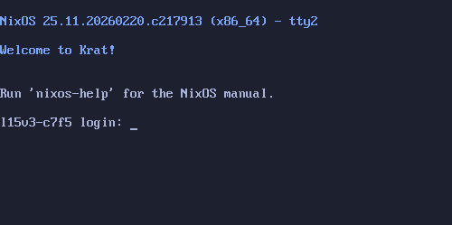

# Ecosystem

If you find something that isn't listed, open an issue or a pull request! 

## Greeters

A list of known zgsld greeters to choose from. 

### [zgsld-agetty](https://github.com/ashametrine/zgsld-agetty)

A small and simple terminal greeter for zgsld that mirrors the familiar `agetty` and `/bin/login` flow, but with support for starting a wider range of sessions, including Wayland and X11 sessions.

## Libraries and daemons

### [zgsld-greetd](https://github.com/ashametrine/zgsld-greetd)

A [greetd](https://sr.ht/~kennylevinsen/greetd/)-compatible daemon and IPC codec library built with ZGSLD.
